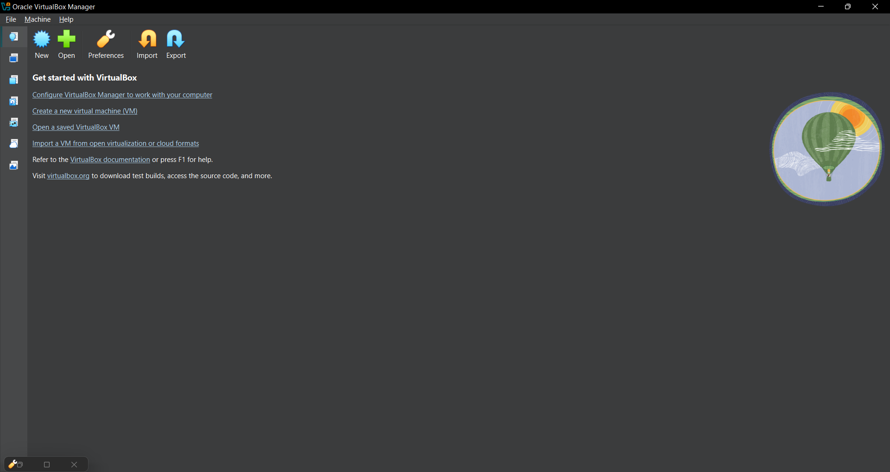
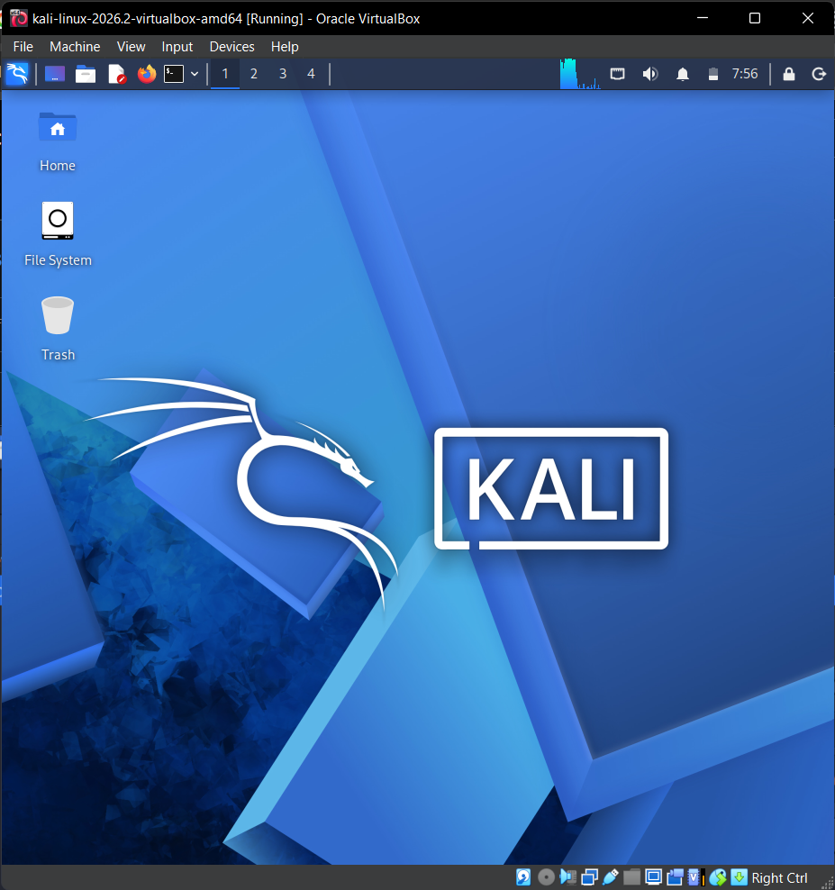

<div align="center">

# 🔐 Cybersecurity Lab Setup

Building a virtual environment for cybersecurity learning and ethical hacking practice.

</div>

---

## 📌 Project Overview

This project documents the setup of a cybersecurity laboratory using VirtualBox and Kali Linux.

The purpose is to create a virtual environment for learning and practicing cybersecurity concepts, including networking security,vulnerability assessment and authorized penetration-testing activities.

The lab uses a private NAT Network with the address range `10.0.0.0/24`, while Kali Linux is assigned the IP address `10.0.0.2/24`. This setup provides a foundation for adding more virtual machines in the future for authorized security testing.

The environment will also support future cybersecurity projects and practical exercises.

## 🎯 Objectives
The main objectives of this project are to:

- Install 7-Zip to extract and manage virtual machines
- Install and configure VirtualBox.
- Build a dedicated NAT Network using the `10.0.0.0/24` address range.
- Download and set up Kali Linux.
- Configure Kali Linux with the static IP address `10.0.0.0/24`.
- Test the network configuration to confirm connectivity and DNS resolution.
- Confirm that Kali Linux can access the internet.
- Save a clean snapshot of the virtual machine to make it easier to restore the environment if needed.
- Record the setup steps and configurations for future reference.
- Establish a reliable virtual lab for upcoming cybersecurity experiments and practical exercises.

## 🛠️ Tools and Purposes

| Tool | Purpose |
|---|---|
| VirtualBox | Running virtual machines |
| Kali Linux | Cybersecurity learning environment |
| 7-Zip | Extracting compressed files |
| NAT Network | Virtual network configuration |
| GitHub | Documenting and sharing the project |

## ⚙️ Lab Configuration

| Component | Configuration |
|---|---|
| 🖥️ Host OS | Windows 10 |
| 🧰 Hypervisor | VirtualBox 7.2 |
| ⚡ Processor | Intel Core i7 |
| 🌐 Virtual Network | NAT Network |
| 🐉 Security OS | Kali Linux
| 📡 Network Address | `10.0.0.0/24` |
| 🐧 Kali Linux IP Address | `10.0.0.2/24` |
| 🚪 Default Gateway | `10.0.0.1` |
| 🌍 DNS Server | 8.8.8.8 |
| 📸 VM Snapshot | Required |

## 🏗️ Lab Architecture

The lab consists of:

- **Host machine:** My physical laptop running the host operating system.
- **VirtualBox:** The virtualization software.
- **Kali Linux:** The virtual machine used for cybersecurity practice.
- **NAT Network:** The virtual network connecting the lab to external networks.

Additional virtual machines may be added for future exercises.

## 🪜 Lab Setup Procedure

### Step 1: Install 7-Zip

Download and install 7-Zip if required to extract the Kali Linux virtual machine files.

### Step 2: Install VirtualBox

Download and install VirtualBox on the host computer.




### Step 3: Create the NAT Network

Create a NAT Network in VirtualBox with the required subnet:

`10.0.0.0/24`

This network will provide the virtual networking environment for the lab.

### Step 4: Set Up Kali Linux

Download Kali Linux from its official website and import the virtual machine into VirtualBox.

Configure the virtual machine's network adapter to use the created NAT Network.



##  Step 5: Configure the Kali Linux Network

Configure Kali Linux to use the required IP address:

```text
IP Address: 10.0.0.2
CIDR:       /24
```
Check the network settings, gateway, DNS configuration, and connectivity.
Verify that these features work as intended.

### Step 6: Take a Virtual Machine Snapshot

After the lab has been configured and verified, create a VirtualBox snapshot.

A snapshot provides a recovery point that can be used to return the virtual machine to its saved state.

## 🔎 Lab Verification

The lab environment should be tested to confirm that the network settings and shared features are working as expected.

| Test | Command / Check | Expected Result |
|---|---|---|
| 🌐 Check IP address | `ip a` | `10.0.0.2/24` displayed |
| 📡 Test network | `ping 10.0.0.1` | Successful replies |
| 🌍 Test Internet | `ping 8.8.8.8` | Successful replies |
| 🔎 Test DNS | `ping google.com` | Domain resolves |
| 🧰 Verify Nmap | `nmap -- version` | Nmap version displayed|  
| 📸 Verify snapshot | Check VirtualBox snapshots | Snapshot available |

## 🧠 What I Learned

Through this project, I improved my understanding of:

- Virtualization and virtual machines.
- Basic network configuration.
- IPv4 addressing and subnetting.
- NAT Network functionality.
- Kali Linux administration.
- Cybersecurity lab preparation.
- Technical documentation using GitHub.

## 🔐 Ethical Use

This lab is intended for educational purposes and authorized security testing only. Any future security assessments should be conducted on systems I own or have explicit permission to test.

## 📚 References

- VirtualBox: https://www.virtualbox.org/wiki/Downloads
- Kali Linux: https://www.kali.org/get-kali/
- 7-Zip: https://7-zip.org/download.html

---

## 👧 Author
**Owoseni Fiyinfoluwa Faithfulness**

Cybersecurity Intern at Network Walks

## 📌 Project Information 

**Project:** Cybersecurity & Penetesting Lab Setup|
**Week:** 01|
**Program Name:** Cybersecurity at Networkwalks|
**Repository:** Github
