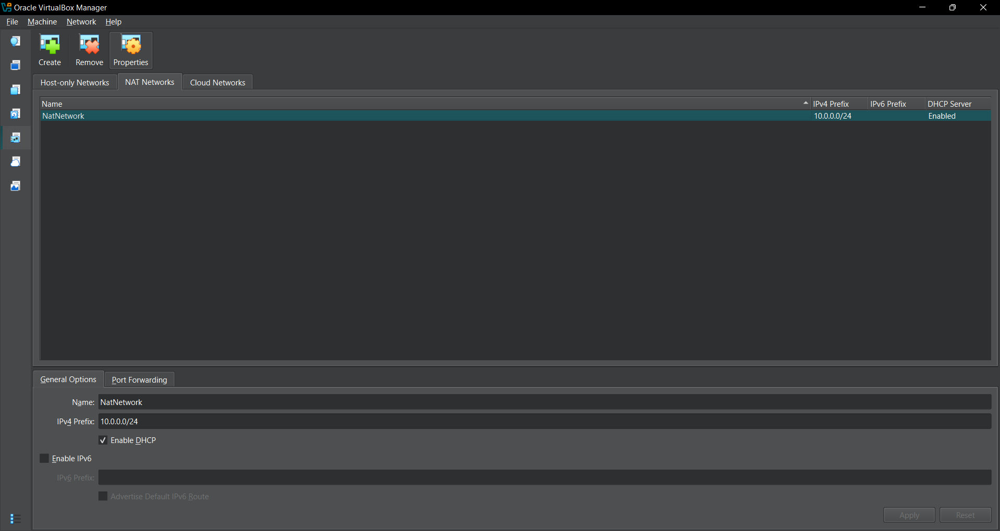

<div align="center">

# 🔐 Cybersecurity Lab Setup

Building a virtual environment for cybersecurity learning and ethical hacking practice.

</div>

---

## 📌 Project Overview

This project documents the setup of a cybersecurity laboratory using VirtualBox and Kali Linux.

The purpose is to create a virtual environment for learning and practicing cybersecurity concepts, including networking security,vulnerability assessment and authorized penetration-testing activities.

The lab uses a private NAT Network with the address range `10.0.0.0/24`, while Kali Linux is assigned the IP address `10.0.0.2/24`. This setup provides a foundation for adding more virtual machines in the future for authorized security testing.

The environment will also support future cybersecurity projects and practical exercises.

## 🎯 Objectives
The main objectives of this project are to:

- Install 7-Zip to extract and manage virtual machines
- Install and configure VirtualBox.
- Build a dedicated NAT Network using the `10.0.0.0/24` address range.
- Download and set up Kali Linux.
- Configure Kali Linux with the static IP address `10.0.0.0/24`.
- Test the network configuration to confirm connectivity and DNS resolution.
- Confirm that Kali Linux can access the internet.
- Save a clean snapshot of the virtual machine to make it easier to restore the environment if needed.
- Record the setup steps and configurations for future reference.
- Establish a reliable virtual lab for upcoming cybersecurity experiments and practical exercises.

## 🛠️ Tools and Purposes

| Tool | Purpose |
|---|---|
| VirtualBox | Running virtual machines |
| Kali Linux | Cybersecurity learning environment |
| 7-Zip | Extracting compressed files |
| NAT Network | Virtual network configuration |
| GitHub | Documenting and sharing the project |

## ⚙️ Lab Configuration

| Component | Configuration |
|---|---|
| 🖥️ Host OS | Windows 10 |
| 🧰 Hypervisor | VirtualBox 7.2 |
| ⚡ Processor | Intel Core i7 |
| 🌐 Virtual Network | NAT Network |
| 🐉 Security OS | Kali Linux
| 📡 Network Address | `10.0.0.0/24` |
| 🐧 Kali Linux IP Address | `10.0.0.2/24` |
| 🚪 Default Gateway | `10.0.0.1` |
| 🌍 DNS Server | 8.8.8.8 |
| 📸 VM Snapshot | Required |

## 🏗️ Lab Architecture

The lab consists of:

- **Host machine:** My physical laptop running the host operating system.
- **VirtualBox:** The virtualization software.
- **Kali Linux:** The virtual machine used for cybersecurity practice.
- **NAT Network:** The virtual network connecting the lab to external networks.

Additional virtual machines may be added for future exercises.

## 🪜 Lab Setup Procedure

### Step 1: Install 7-Zip

7-Zip was installed to extract compressed files needed for the lab setup, including the Kali Linux virtual machine files.                                                   

### Step 2: Install VirtualBox

VirtualBox was installed on the host computer as the hypervisor.


### Step 3: Create the NAT Network

A dedicated NAT Network was created in VirtualBox with the required subnet:

`10.0.0.0/24`



A NAT Network was configured to enable communication between multiple virtual machines within the cybersecurity lab while providing outbound connectivity to external networks. This setup offers flexibility for future lab exercises, allowing additional attacker and target machines to be connected and interact within the same virtual environment.

### Step 4: Set Up Kali Linux

Kali Linux was downloaded from its official website and imported into VirtualBox.


##  Step 5: Configure the Kali Linux Network

Kali Linux was configured to use the required IP address:

```text
IP Address: 10.0.0.2
CIDR: /24
Gateway: 10.0.0.1
DNS: 8.8.8.8 
```
The network configuration was reviewed to confirm the gateway settings, DNS resolution, and overall connectivity, ensuring that all network components were functioning as expected.


### Step 6: Create a Virtual Machine Snapshot

After the lab has been configured and verified, a VirtualBox snapshot was created.

The snapshot provides a recovery point that can be used to return the virtual machine to its saved state.
```text
Kali-Linux-Initial-Setup
```

## 🔎 Lab Verification

The lab environment was tested to confirm that the network settings and shared features were working as expected.

| ✅ Test | 📜 Command | 🎯 Expected Result |
|---|---|---|
| 🌐 Check IP address | `ip a` | `10.0.0.2/24` displayed |
| 📡 Test network | `ping 10.0.0.1` | Successful replies |
| 🌍 Test Internet | `ping 8.8.8.8` | Successful replies |
| 🔎 Test DNS | `ping google.com` | Domain resolves |
| 🧰 Verify Nmap | `nmap -- version` | Nmap version displayed|  
| 📸 Verify snapshot | Check VirtualBox snapshots | Snapshot available |

## 💡 What I Learned

This project provided hands-on experience in preparing a virtual environment for cybersecurity practice and understanding the basic configurations required to build a functional lab.

Some of the key things i learned from this project include:

### 1. Setting Up a Virtual Environment

I learned how to use VirtualBox to run Kali Linux on my computer without replacing my main operating system. This gave me a separate environment where I could configure the system and prepare it for cybersecurity practice.

### 2. Setting Up the Lab Network

I learned how to create a NAT Network in VirtualBox and connect my Kali Linux VM to it. This will make it possible to add other virtual machines to the lab and allow them to communicate with one another.

### 3. IP Addressing and Network Checks

I learned how IP addresses and subnet masks are used to identify devices on a network. I also checked the gateway, DNS settings, and connectivity to make sure the Kali Linux VM could connect to the network properly.

### 4. Managing Virtual Machines

I learned how to import Kali Linux into VirtualBox, adjust its settings, configure the network adapter, and take snapshots. I also understood how snapshots can help me return to a previous state if something goes wrong during future lab exercises.

### 5. Lab Documentation

I learned how to document the lab setup by keeping screenshots and important configuration details. This will help me remember the steps I followed and make it easier to fix problems or set up the lab again in the future.

## 🔐 Ethical Use

This lab was set up for cybersecurity learning and practice in a safe environment. All testing activities will be performed responsibly and only on systems I own or have received proper authorization to test.

## 🔗 Tools & Resources

- VirtualBox: https://virtualbox.org/wiki/Downloads
- Kali Linux: https://kali.org/get-kali
- 7-Zip: https://7-zip.org/download.html

---

## 👧 Author
**Owoseni Fiyinfoluwa Faithfulness**

Cybersecurity Intern at Network Walks

## 📌 Project Information 

**Project:** Cybersecurity & Penetesting Lab Setup|
**Week:** 01|
**Program Name:** Cybersecurity at Networkwalks|
**Repository:** Github
